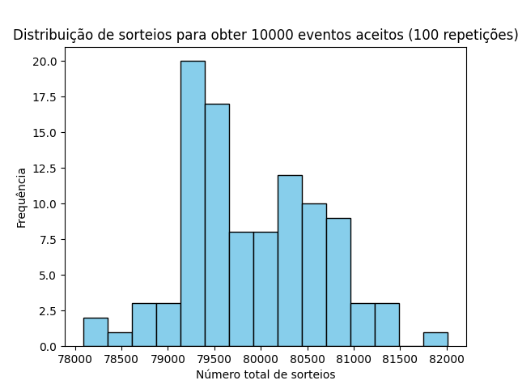
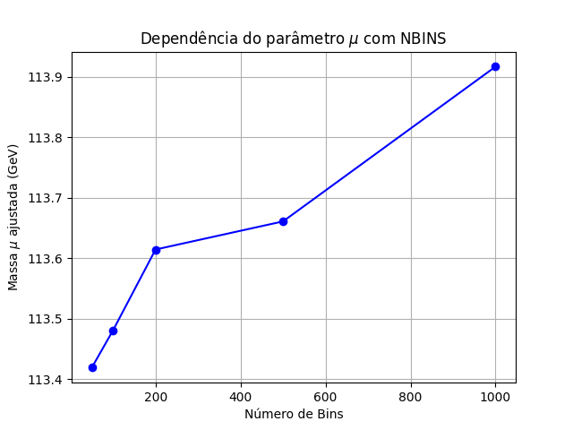

# Lista de Exercícios: Monte Carlo e Ajuste de Curvas com Minuit
F056 - Métodos Computacionais em Física de Altas Energias

## Instruções de Execução e Dependências
Para executar os scripts desta lista, certifique-se de ter as seguintes bibliotecas instaladas no seu ambiente Python:
`numpy`, `scipy`, `matplotlib`, `iminuit` e `uproot`.

**Como rodar os códigos no terminal:**
1. Problemas 1 e 2: Execute `python3 problemal_2_aceita_rejeita.py`. O script não necessita de ficheiros de dados externos e guardará o histograma na pasta `figuras/`.
2. Problema 3: Execute `python3 ajuste_higgs_melhorado.py`. É estritamente necessário que o ficheiro `pythia_higgs.root` esteja presente no mesmo diretório do script para que a extração de dados funcione.

## Parte I - Método de Monte Carlo (Problemas 1 e 2)
Na simulação da distribuição normal Padrão no intervalo [-5, 5], foram necessários 80504 sorteios para obter 10000 eventos aceite. A eficiência obtida foi de 0.2484, o que está em excelente concordância com a eficiência teórica esperada de 0.2507[cite: 7].

Ao variar o intervalo, a eficiência decresce:
* Intervalo [-3, 3]: Eficiência = 0.4195
* Intervalo [-5, 5]: Eficiência = 0.2588
* Intervalo [-10, 10]: Eficiência = 0.1251
Isto ocorre porque, ao aumentarmos o intervalo $[x_{min}, x_{max}]$, a área do retângulo delimitador aumenta significativamente nas caudas da Gaussiana (onde a probabilidade é quase nula), aumentando a taxa de rejeição.

## Parte II - Ajuste de Curvas com Minuit (Problema 3)
O código original foi melhorado corrigindo a variância do qui-quadrado (agora baseada na previsão do modelo, `np.maximum(previsao, 1.e-3)`), libertando o parâmetro do pico da Breit-Wigner e inicializando os parâmetros de forma consistente e proporcional ao número total de eventos extraídos.

**Dependência do número de Bins (NBINS):**
Realizou-se o ajuste para NBINS = 50, 100, 200, 500 e 1000. O gráfico abaixo demonstra que a massa ajustada ($\mu$) sofre uma ligeira variação (entre 113.4 GeV e 113.9 GeV) consoante a discretização dos dados[cite: 11]. 
Esta sensibilidade é uma desvantagem inerente aos métodos de ajuste binned (qui-quadrado), uma vez que a informação exata da posição de cada evento é perdida dentro da largura do bin. Em contraste, o método de Máxima Verossimilhança não binado avalia a PDF evento a evento, sendo imune a este efeito e geralmente mais preciso para amostras onde a discretização afeta o formato do pico.

